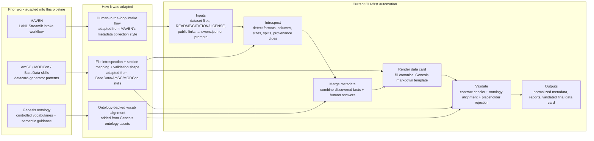

# Executive Overview: Datacard Automation

## Narrative

- `MAVEN` contributed the intake philosophy: collect metadata in batches, keep a human in the loop, and make the workflow practical for real dataset stewards.
- `AmSC / MODCon / BaseData skills` contributed the datacard-generation mechanics: inspect data, infer what can be inferred, map findings into a card structure, and validate the result.
- The `Genesis ontology` adds controlled vocabularies and semantic alignment so generated metadata can be checked against project terminology instead of only local hard-coded enums.
- The current implementation turns those ideas into a `CLI-first pipeline` that starts from dataset artifacts and public/source metadata, produces a normalized metadata object, renders the canonical Genesis data card, validates it, and saves a final validated card plus supporting reports.

## High-Level Flow

1. Gather inputs from dataset files, public landing pages, and steward-provided answers.
2. Introspect what the system can discover automatically.
3. Fill gaps with human-supplied metadata.
4. Normalize everything into the target Genesis card structure.
5. Render the markdown data card.
6. Validate the card against required fields, consistency rules, ontology-backed vocabularies, and placeholder cleanup.
7. Emit the final validated data card and machine-readable run artifacts.
