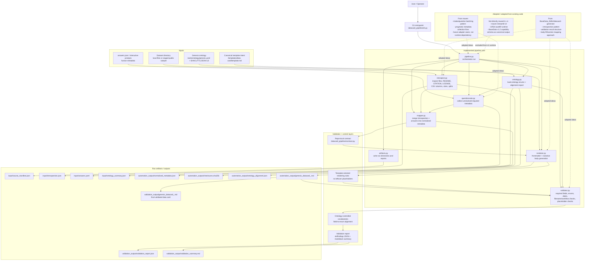

# Datacard Automation Pipeline Diagram

## Notes

- Canonical output target: the provided Genesis markdown datacard template shape, not the `BaseData_Skills` v1.2 capability-container schema.
- Primary execution surface: CLI first. `maven` is a future integration point, not a current runtime dependency.
- Validation stack:
  - contract-driven required fields and profile rules
  - local enum/date/consistency checks
  - ontology-backed vocabulary alignment warnings
  - unresolved-placeholder rejection
- Main adopted behavior:
  - `BaseData_Skills` informed the file introspection, body-fill, and validation model
  - `maven` informed the human-in-the-loop metadata intake flow
- Main outputs:
  - normalized machine-readable metadata
  - rendered markdown datacard
  - validation report
  - ontology alignment report
  - final validated datacard copy
